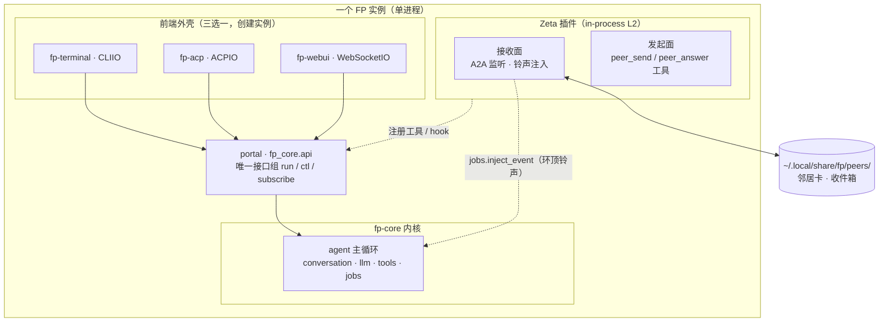
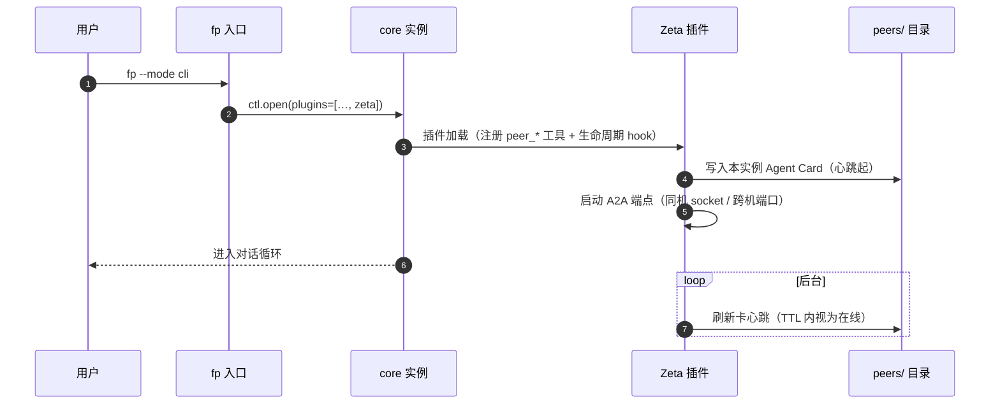
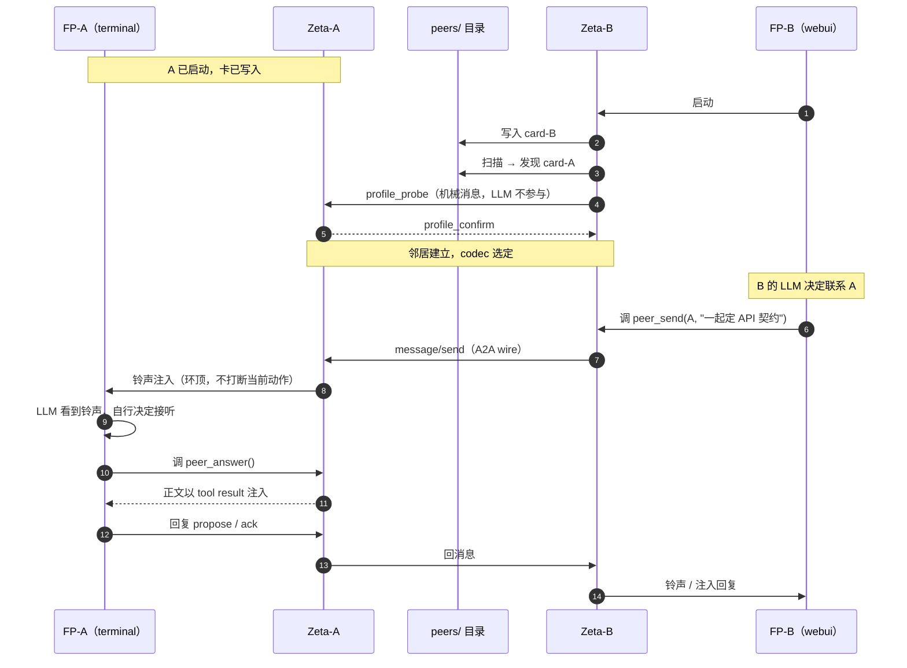
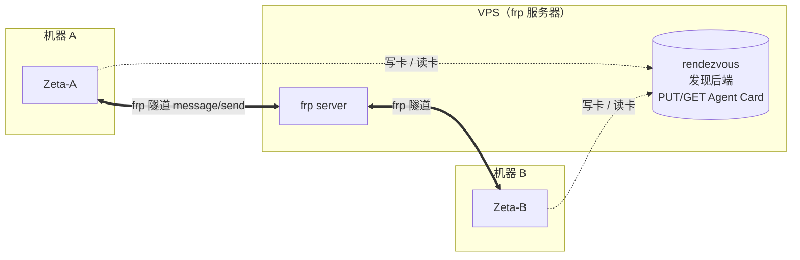

# Zeta 邻居协议

> **状态：已实现并稳定。** 本文是 Zeta 的唯一权威文档。
>
> **代码落点** `packages/fp-core/src/fp_core/plugins/zeta/`：
> `domain.py`（领域模型 / IR）、`discovery.py`（名片、实例登记、GC）、
> `peer.py`（服务层、幂等窗口）、`contracts.py`（契约机）、
> `codec.py` / `a2a_codec.py`（codec）、`transport.py` / `a2a_http.py`（传输）、
> `plugin.py`（装配、铃声接线）。

> **分层门禁**：领域模型层的 import 图中**不得出现** a2a / httpx / socket /
> 任何 codec 与传输库。验收判据：**删掉全部 codec 后，本层测试必须全绿。**
>
> **信任红线**：**LLM 的输出不是可信输入。** 凡进入协议状态（契约、卡、协商结论）的，
> 必须存在一条非 LLM 的确定性校验路径——信任根不许放在任何实例的嘴里。

## 1. 定位

### 1.1 一句话

**Zeta 让多个对等 agent 实例（FP ↔ FP，以及 FP ↔ 外部异构 agent）像邻居一样协作：
没有上下级、可以不同时在线、任一方都能主动找对方，靠一份共同签署的契约达成一致，
而不是靠某个中心的指挥。**

对等原则：无上下级；任一方可主动；不同时在线（邻居搬家无所谓）；
对话动机在实例自己的 LLM 肚子里，不在任何编排器参数里。

Zeta 是**协议翻译网关（路由器），不是隧道**。

### 1.2 与 agent_dispatch 的根本区别

| | agent_dispatch（旧） | Zeta（邻居） |
|---|---|---|
| 协作的抽象 | **函数调用**：spawn → 等 stdout → 拿字符串 | **对话**：投递消息、多轮、可离线留话 |
| 参与者 | 一次性、被阉割的 worker | 完整实例（有自己的工具、记忆、多轮） |
| 关系 | 主编排器是唯一权威（上下文一满就丢线） | 对等，无中心，任一方可发起 |
| 异构 | 只能接自己的子进程 | 能接任何说 A2A 的第三方 agent |
| 一致性 | 主编排器裁决 | **双方共同签署的契约**（谁也不能单方改） |

一句话：**旧模型是「我调用你」，新模型是「我们是邻居，有事打电话商量」。**

### 1.3 分层与两条可验证约束

```
应用语义层   契约 profile（fp-contract-profile）—— 邻居谈成的共享契约
    ↑
领域模型层   NeighborCard / Envelope / 注入策略 / 发现（协议无关的中间表示 IR）
    ↑
Codec 层     a2a_codec | fp_direct_codec | ...（可插拔，一邻居一档）
    ↑
传输层       localhost | tcp | frp（可插拔）
```

两个设计约束贯穿所有层，且都可机器验证：

1. **删掉 codec 后，领域模型测试必须全绿**——协议可替换，形状不渗透进语义；
2. **删掉 contract profile 后，通信仍然可用**——协作范式是通信之上的应用层。

### 1.4 核心不变式（红线）

1. **LLM 的输出不是可信输入**——凡进入协议状态（契约、卡、协商结论）的，
   必须存在一条非 LLM 的确定性校验路径。信任根不许放在任何实例的嘴里。
2. **机械消息永不注入 LLM**——ack/hash/心跳/离线回执由网关直接应答，省钱、缩小幻觉面。
3. **人类无条件优先，且是抢占式的**——远程注入不得决定本地用户体验。
4. **hash 锁字节，schema 锁语义**——LLM 只产候选，一致性由 hash 判，正确性由 schema 判。
5. **兼容性由机器计算，不采信声明**——「我说这是小改动」骗不过 diff 工具。
6. **扩展必须可忽略；安全区未知字段 fail-closed**——忽略它会改变核心语义的，不是扩展，是核心变更。
7. **对话可断可丢，契约不能**——真正持久的产物是契约文件，不是会话。
8. **权威外化到契约**——没有中央，没有「领导进程」；对等网络里没有单方修改权。

## 2. 部署形态与运行时

### 2.1 Zeta 住在哪里：每个实例各带一个 in-process 插件

- 一个前端进程 = 一个 FP 实例。`fp --mode cli|webui|acp` 三选一，
  进程内 `ctl.open()` 建**一个** core 实例（terminal/acp/webui 是三种外壳，互斥）。
- Zeta 作为 **in-process 插件**随实例加载（默认开、可配置关）：
  **用户启动任何前端，就同时拉起了这个实例的 Zeta。**
- 同一用户开两个实例（如一个 terminal、一个 webui），它们就是**对等邻居**；
  跨机则把卡里的 endpoint 换成远端地址，其余机制不变。

**为什么必须是插件形态**：接收面要触达 core 的注入通道，才能直接调
`jobs.inject_event(wake=True)`、注册 `LifecycleHook`、注册 `peer_*` 工具；
前端侧则用 `portal.run.wake()` 主动唤醒。若做成「外部前端 + 插件工具」两体，
这两条通道都够不着。

### 2.2 Zeta 与三前端 / core 的关系



要点：**Zeta 不穿透 portal 去改 core**——它作为插件以 L2 身份合法引用 L1
（`jobs` 注入队列、`LifecycleHook`），这是 core 预留的扩展点，不是绕过。

### 2.3 启动流程（以 terminal 为例）



**启动前端会拉起自己的 Zeta**——每个实例一出生就是邻居网络的一员（默认开）。

### 2.4 两个实例的发现与交换



**离线场景**：若 B 启动时 A 不在线——卡的 TTL 过期 → B 判定 A 离线 →
消息进 `peers/A/inbox/` 收件箱（at-least-once + 幂等键）→ A 下次上线扫描投递。
**发现靠共享目录、交换靠 A2A，两者都允许对方不在线。**

### 2.5 跨网络：发现与传输都是可插拔插槽

**核心统一：把「发现」和「传输」都做成插槽**——同机用文件 + 本地 socket，
跨机用 rendezvous + 隧道，领域模型不感知差别。

| 插槽 | 同机 | 跨机 |
|---|---|---|
| 发现后端 | `SharedDirBackend`（`~/.local/share/fp/peers/`） | `RegistryBackend`（VPS 上的 rendezvous：HTTP PUT/GET 卡）或 `StaticConfigBackend`（配置写死邻居） |
| 传输 | local socket | frp 隧道（VPS 中转） |



**功能优先、允许稍不安全**：跨机 MVP 用最简方案——静态配置邻居清单（写死 frp 地址）
或一个共享的 rendezvous 目录（VPS 上的文件 / HTTP），明文 + 共享 token 认证即可。
不上 OAuth / 零信任，等真需要再说。

所以「跨网络如何处理」的答案是：**没有文件夹，就把文件夹换成一个 rendezvous 后端**——
与同机机制同构，只是发现后端换实现。（公网互联的具体选型见 §11.1，尚未实现。）

### 2.6 一次完整协作的故事（后端 ↔ 前端）

```
1. 发现    A、B 各自在共享目录写自己的卡；启动扫描时互相看见
2. 拨号    A 的 LLM 干到一半发现要定 API → 调 peer_send(B, propose)
3. 传话    B 的 Zeta 收到 → 忙则入队，闲则注入 B 的实例
4. 协商    A: propose(契约全文, hash=X) → B 校验（结构/作用域/兼容/安全区）
           → B: ack(hash=X) 或 counter(hash=Y)
5. 落盘    hash 对上 → 双方签名 → 契约进交换区（写权：提议方写、确认方校验）
6. 干活    各自按契约建自己的代码，谁也没改对方的文件
7. 演进    要改契约 → 走 expand-contract：加字段→迁移期→全员验证后才收缩
```

**离线时**：B 没开机 → A 的 `peer_send` 立即拿到「对方离线」回执 → A 决定
「用默认契约先干 + 留待补议」或等下次。**邻居搬家了也无所谓。**

**异构时**：对方是外部 A2A agent → 按其卡的能力声明决定协商深度；
只会裸 A2A → 降级模式，结果标 UNVERIFIED，落盘前过本地 schema 校验。

## 3. 邻居发现与名片

发现：同机共享目录 `~/.local/share/fp/peers/<name>.json`。
**每实例只许写自己的卡**（`O_EXCL` 创建自己的文件，不碰别人的）；读取方验签 +
比对 `card_hash` + 校验心跳新鲜度。跨机时 endpoint 换远端地址，卡形状不变。

### 3.1 NeighborCard

```python
@dataclass
class NeighborCard:
    name: str                     # 邻居唯一名（参与同时发起的字典序裁决）
    kind: str                     # FP_INSTANCE | EXTERNAL_A2A_AGENT
    # ── 业务身份（路由依据）──
    workspace: str                # 记忆/任务归属边界（路由键，见 §3.5/§3.6）
    business: str                 # 主要业务/职责（自然语言，路由的核心依据）
    tags: list[str]               # 业务标签："backend"|"frontend"|"research"|"infra"|...
    # ── 运行状态 ──
    status: str                   # idle | busy | away
    current_task: str | None      # 当前任务摘要（打电话的人据此判断忙不忙）
    started_at: float
    # ── 技术能力 ──
    endpoints: list[Endpoint]     # 多端点 + priority：local:// | tcp:// | frp://
    codec: str                    # 首选 codec："a2a" | "fp_direct"
    capabilities: Capabilities    # 见下
    roles: list[str]              # 自我声明立场（非指派）："backend", "frontend", "verifier"
    trust: TrustLevel             # TRUSTED_PEER | KNOWN | STRANGER（见 §3.2）
    heartbeat: float              # unix ts；offline_threshold = 3× 心跳周期
    card_hash: str
    sig: str | None               # 卡签名（STRANGER 互访强制）
    issued_at: float              # 过期卡自动失效（防 stale 记录）
```

```python
@dataclass
class Capabilities:
    profiles: list[str]           # 支持的 profile："fp-contract-profile", "bare-a2a", ...
    semantic_layers: str          # MECHANICAL_ONLY | SEMANTIC_CAPABLE
    max_envelope_bytes: int | None
    supports_idempotency: bool
    # 注：不声明角色与意图，只声明"我接得住什么"——意图是会话期消息的事
```

`cwd` 不再是身份键、不参与路由（理由见 §3.6）；它只是进程的一个属性。

### 3.2 信任档与安全闸门

| trust | 跨进程消息进 prompt | 危险工具（bash/edit） | 协商模式 |
|---|---|---|---|
| TRUSTED_PEER（同机熟人） | 标注来源 + 长度上限 | 默认可用 | 完整 hash+schema 共识 |
| KNOWN（互访过） | 标注来源 + 长度上限 | 提级确认 | 完整 hash+schema 共识 |
| STRANGER（裸外部） | 强制边界标记 + 严格上限 | 强制确认/白名单 | 降级：schema 校验兜底 |

规则：

- **信任升级只能由本地策略决定**，不能凭对端声明——「连续 N 条消息无异常」这类部署策略配置；
- 信任标签由**发送方填写、接收方覆盖**（接收方永远有权降级）；
- **降级是降带宽，不是降信任检查**——降级模式同样要过 §3.3 的会话期验卡。

### 3.3 发现目录的防投毒

1. 每实例只写自己的文件，写入原子替换（临时文件 + rename），防半写读取；
2. 卡签名 + `issued_at`：读取时验签、比 `card_hash`、过期即失效；
3. **每次会话建立时重新验卡**，降级模式不允许绕过此步——防止 stale 卡把
   会话引向已变更能力（或已被顶替）的对端；
4. 目录是**发现缓存，不是信任源**：真正的信任判定在本地 trust 档 + 会话期校验。

### 3.4 发现必须告知 LLM（功能优先）

**问题**：若邻居发现只发生在 Zeta 层（机械层），双方的 LLM 根本不知道对方存在，
就不会产生「找他商量」的动机——**发现等于没发现**。

**规则**：**发现事件要注入 LLM**（与铃声同通道，环顶注入）：

```
【邻居】peer:B 上线（能力=contract/query，端点 local://B）→ 可用 peer_list 查看
```

- 新邻居首次上线 → 注入一次简报；
- 邻居离线 / 换端点 → 可选注入；
- 提供 `peer_list()` 工具，LLM 可随时查邻居表。

**边界（机械/语义的分界）**：

- 协议层的机械消息（`profile_probe` 等）**仍不进 LLM**（那是网关自己的握手）；
- 但**发现结果**（谁在线、有什么能力）是**语义事件**，必须进 LLM；
- **功能优先**：不为「防打扰」牺牲「能发现」——宁可多注入一条简报。

### 3.5 名片即路由表（功能优先）

**问题**：若名片只有技术能力（profiles/codec），打电话的人无法知道「该找谁」——
只能把请求群发给所有邻居，**把所有人骚扰一遍**。

**解法**：名片携带**业务身份**——`workspace` / `business` / `tags` / `status`。打电话的人
**先 `peer_list()` 拉全部名片，本地筛选出「对的人」，再单发**——零骚扰。

```
【邻居】peer:B 上线
  ws = repo://.../agent    business = "FP 平台开发（core + 协议）"
  tags = [backend, infra]  status = busy
  当前 = Zeta 契约 schema 设计
```

- 路由依据优先级：`name`（精确点对点）> `tags`（能力）> `business`（职能）> `workspace`（同项目）；
- 「同项目」判据明确为 **workspace 相等**，而非 cwd 字符串相近；
- `status=busy` → 打电话的人可据此决定「现在发还是待会发」（配合铃声 / 离线留话）。

**`business` 从哪来**（功能优先的实用路径）：
1. 启动声明（`fp --as "后端"`）——最可靠；
2. 或从启动目录推断（项目名 / README 首行）；
3. 或由实例 LLM 开工后自我更新名片（`peer_set_business()` 工具）。

先支持 1+2，第 3 项是增强。

### 3.6 身份与实例：workspace 1:N，身份锚点 = sid

#### 3.6.1 三分解耦

早期设计把「一个路径 ↔ 一个邻居」写死（一目录一实例，cwd 即身份键），
把**位置**误当成**身份**，代价在「同一项目并行多个 agent」时集中爆发：

| 症状 | 真实体验 |
|---|---|
| 并行受限 | 同一目录开不了第二个实例，被迫换目录 |
| 记忆不共享 | 换了目录 → `.fp/memory` 分叉 → 同项目记忆割裂 |
| 路径指代不明 | 路由键是 cwd，路径相近/同名时谁是谁分不清 |
| 名称不稳 | `name = basename(cwd)+pid`，reload 换名、旧卡变僵尸 |

根因是四个本应正交的概念被强绑成 1:1:1:1（`workspace ≡ instance ≡ identity ≡ cwd`）：

| 概念 | 本义 | 应然关系 |
|---|---|---|
| **workspace** | 记忆/任务的归属边界（`.fp/` 所在） | 1 : N（可挂多实例） |
| **instance** | 一次运行的进程 | N : 1 |
| **identity** | 我是谁、如何被寻址 | 独立、稳定、唯一 |
| **cwd** | 进程当前所在目录 | 只是实例的一个**属性** |

两条关键洞察：

- **记忆分叉不是记忆机制的问题**。`.fp/memory/`、`.fp/tasks.json` 本来就是
  workspace 级、同目录共享的。**记忆割裂 = 单实例锁逼出来的**：锁不让同目录开第二个
  实例 → 人换目录 → `.fp/` 分叉。撤掉那道锁就解决，**一行记忆代码都不用改**。
- **人格就是上下文，锚点是 sid**。不需要给实例「额外起名」：
  一个「人格」= 一段长期上下文 = 一个会话（sid）。sid 全局唯一、reload/resume 稳定，
  天然是身份的锚点；「召回一个人」= `fp -r <sid>`。

**不变量**

- 身份是**本地策略**，不进 wire —— codec/transport 不感知身份如何生成。
  验证：删掉 a2a codec，身份相关测试仍全绿。
- 权限红线不变：实例只写自己的名片与收件箱。
- 「一目录一实例」的**能力**保留为可选策略（`FP_ZETA_SINGLE=1`），不再默认。

#### 3.6.2 workspace : instance = 1 : N

`.fp/` 下改用**每实例一个登记**（替代单文件单锁）：

```
<workspace>/.fp/zeta/instances/<name>.json   # {name, sid, pid, workspace, cwd, started_at}
```

- 启动**不再拒绝**第二实例；各写自己的登记（写隔离不破）；
- 启动时扫描同目录其他登记，`pid` 已死的 → 回收（`sweep_stale`）；
- **`pid == 本进程` 的登记 = 本实例的前身 → 接管，不判冲突**（reload 语义，见 §3.6.4）；
- 退出删自己的登记。

**副产品**：同 workspace 多实例 → `.fp/memory`、`.fp/tasks.json` **自动共享**。

要隔离就用不同 workspace（目录）；这是目的，不是缺陷。

#### 3.6.3 身份锚点 = sid

**唯一锚点：会话 sid。** 没有 `--as` 命名层、不用 pid、不用 workspace-hash。

```
name := <workspace名>-<sid 短handle>      # 唯一、reload 稳定、不可读无所谓
```

- **handle = `sha256(sid)[:8]`**——不可逆、**不把原 sid 暴露给邻居**，避免泄露本地会话标识；
- **不可读不是问题**：name 是**机器 handle**（寻址用），可读性由 `business`/`tags`/
  `workspace` 承担——筛选看这些，选定后用 `name` 精确点对点；
- **`--as` 降级为可选显示昵称**（写进 `business`），**永不是身份锚点**。

**生命周期 → 身份映射**：

| 操作 | sid | 身份 |
|---|---|---|
| reload（热重启） | 不变（`FP_RELOAD_SID`） | **不变** |
| `fork_new` / `switch_to` | 变 | 变 / 切换（新人格 / 召回旧人格） |
| `clear` | 不变（只清内容） | 不变（失忆） |
| 进程退出 | 留住磁盘 | 可 `resume` 召回 |

**两种寻址统一于 sid**：
- 人类召回 → `fp resume`（列出会话）→ 选中 → 人格回来；
- 机器寻址 → `peer_list` 拿 name → `peer_send`。

#### 3.6.4 reload 接管：PID 不变，登记会「自吞」

`fp` 的 reload 是 **`os.execve` 映像替换**（`core/handoff.py` +
`platform_utils.restart_self`）：进程原地重生，**PID 不变**，且**没有任何
shutdown 钩子会跑**（没有「退出」这一步可挂）。

三个事实叠加 → 一个必然的自噬：

1. 旧化身的登记文件残留（没人注销）；
2. `pid` 判活为**真**——那就是我自己；
3. sid 稳定 ⇒ `derive_instance_name` 派生**同名**。

⇒ 新化身把自己上一条登记当成「别人占着这个名」，降级、**邻居面永久丧失**
（`peer_*` 工具还在，但只会返回「实例登记冲突」）。这不是偶发竞态，是**每次
reload 必现**。

**规则（唯一正确判据）**：`pid == 本进程 pid` 的登记**只能**是本实例的前身
——一个进程不可能同时跑两个同名实例。故 `acquire` 直接**接管**（覆盖为自己、
刷新 `started_at`），不判冲突。

同理覆盖两类「同进程换宿主」：进程内 Agent 重建（如 portal recycle）、同进程内
插件重新装配——它们都是同一身份的新化身，不是竞争者。

**Windows 差异**：reload 走「spawn 新进程 + 旧进程 `_exit`」，PID 变。新旧交替
有毫秒级窗口，旧进程尚在 ⇒ `acquire(takeover_wait=0.5)` 短暂等待其让位，把
「交接窗口」与「真冲突」区分开（真冲突 = 占用者是**别的活进程**且不让位）。

**没有采用的替代方案**（记录以免重复走）：

- 「reload 前先跑 shutdown 钩子释放登记」——要在 `perform_exec_reload` 里发
  `ON_SHUTDOWN`，会牵动 `builtin_shutdown`（清算 jobs、生成摘要、退出面板），
  且 execve 失败时「旧进程无损」的救火承诺作废；判据在进程身份上更小更稳。
- 「登记加心跳 TTL，陈旧即接管」——reload 前后心跳只差几秒，仍在 TTL 内，
  挡不住；且会把真正卡住的活实例误接管。

#### 3.6.5 冲突语义与降级可见

仅**同名**（同 sid）且占用者是**别的活进程**才冲突——不同 sid 的实例可同 workspace
共存，同 pid 的「同名」是自己的前身（§3.6.4）。

冲突时第二个实例 fp 照常启动、**不启用邻居面**，但 `peer_*` 工具**照常注册**、
调用返回明确原因、system prompt 追加「本实例邻居面当前不可用——<原因>」。

理由：这是「发现必须告知 LLM」的同一条原则——**静默消失等于能力不存在**。
**显式关闭**（`FP_ZETA_DISABLE=1`）另当别论：用户明确不要 → 不注册工具、不注入说明。

#### 3.6.6 跨 workspace resume 的错配

sid 全局，`.fp/memory` 是 workspace 级 —— `/projA` 的会话 X 在 `/projB` 里 `fp -r X`：
**人格来自 A，记忆读 B**。

**定案**：workspace 跟**启动目录**，首次错配经 system prompt 提示一次。
理由：记忆是「这片代码库的知识」，跟着代码库走，不被对话拖走。

### 3.7 发现目录卫生：可达性 GC

发现目录是**全机共享**的（`~/.local/share/fp/peers/`），而每张名片的名字由 sid 派生
⇒ **每个新会话 +1 张卡 +1 个收件箱**，无天然回收。实测 54 张卡时 `scan()` 2.5ms、
每 2s 一次 ⇒ 每实例每天约 108s 空转（92% 花在死卡片上），且随会话数线性增长。

**判据是「可达性」，不是「时间到了」**——名片要回收需**同时**满足两条（缺一不删）：

1. 心跳过期超过 `GC_CARD_GRACE`（7 天）；TTL 90s 只判「离线」，与「可回收」是两回事；
2. 其 `workspace` 下已无同名**活登记**（回查 `.fp/zeta/instances/<name>.json` 的 pid；
   读不了/判不了 → **保守保留**）。

名片本质是派生缓存（活实例每 2s 重发），误删也会秒级自愈——这不是宽容，是设计。

**真正的红线在收件箱**：顶层有未读留话 → **永不删**。名字由 sid 派生，会话 resume 即同名、
上线即读到，删了就永久丢消息（「离线留话」语义的唯一落点）。无未读且对应名片已死/不存在
→ 整目录回收（含 `.processed`：它只由**活**实例的 housekeeping 清，实例死了便永无人清）。

**并发**：多实例可能同时 GC → `FileLock(<root>/.gc.lock)` 非阻塞互斥，拿不到就跳过
（不算失败，按「本轮别人做了」处理）。**触发**：`plugin._maybe_gc` —— 启动一次 + 每 24h。

实现：`discovery.collect_garbage()` / `GcReport` / `instance_alive()`；测试
`tests/test_zeta_gc.py`（15 例）。

**已知边界**见 §11.3。

## 4. 消息信封

### 4.1 Envelope

```python
@dataclass
class Envelope:
    id: str                       # 全局唯一（uuid/ULID）
    correlation_id: str           # 同一议题线程共享
    reply_to: str | None          # 回复链
    idempotency_key: str | None   # 幂等键：重试/重放共享；去重窗口 ≥ TTL（建议 24h）
    from_: str
    to: str                       # 单播；广播 = 多次单播
    kind: MsgKind                 # MECHANICAL | SEMANTIC
    ttl: Ttl                      # {deadline, max_hops} —— 取先到者；MVP 单跳，max_hops 预留
    sent_at: float
    payload: Payload
    codec_meta: dict | None       # codec 专属元数据，IR 视为不透明 kv，不解释
    sig: str | None
```

**`kind` 分流是成本与安全的双闸门**：

- `MECHANICAL`：**MUST NOT 注入 LLM**，Zeta 层直接应答——profile 协商、
  ack/hash 确认、心跳、离线回执、超限通知；
- `SEMANTIC`：才注入实例（propose、counter、clarify），走 `portal.run.send`。

```python
@dataclass
class Payload:
    kind_mech: str | None         # MECHANICAL 用："profile_probe" | "ack" | "nack" | ...
    # ── SEMANTIC 用 ──
    topic: str | None             # "contract" | "task" | "chat"
    body: str | None              # 语义文本
    parts: list[Part] | None      # Artifact 多 part：text/file/data，非裸 string
    injection: InjectionHint | None

@dataclass
class InjectionHint:
    inject_as: str                # USER_MESSAGE | SYSTEM_CONTEXT | TOOL_RESULT | NOTIFICATION
    trust_label: str              # TRUSTED_PEER | UNTRUSTED_CONTENT（生成规则见 §3.2）
    max_context_tokens: int | None
```

**注入管线硬规则**：

- `UNTRUSTED_CONTENT` **MUST** 走 `USER_MESSAGE`，用显式边界标记包裹
  （如 `<untrusted_peer_content>...</untrusted_peer_content>`），SHOULD 过注入检测；
- 每次注入记审计日志：`envelope_id` / `sender` / `trust_label` / `inject_as`。

### 4.2 展示名 vs 寻址名：`peer:` 前缀必须归一

展示层统一写成 `peer:<name>`（邻居简报、铃声、接听回执都这样），因为对 LLM 来说
「这是一位邻居」比裸名字信息量更大。代价是 **LLM 会把展示名原样抄进 `to`**——
于是 `to` 存在两套写法，而寻址只认其中一套：

| 写法 | 归一后 | 收件箱目录 |
|---|---|---|
| `B` | `B` | `<root>/B.inbox` |
| `peer:B` / `PEER：B` / `` `peer:B` `` | `B` | `<root>/B.inbox`（同一个） |

**MUST**：所有寻址入口先过 `domain.normalize_peer_name()` —— 工具参数（`peer_send` /
`peer_propose` / `peer_ack`）、服务层（`PeerService.find/send`，决定 `online` 判断与
信封 `to`）、传输层（`DirTransport._safe`，决定目录路径）。三处都归一 = 纵深防御：
任何未来调用方都不会因为「名字带前缀」而把消息投进 `peer<name>.inbox`。

**历史教训**：只做字符过滤而不归一，消息会落到 `peer<name>.inbox`，而收件人轮询的是
`<name>.inbox`——**落盘成功、回执报「已留话」、永远没人读**。这是最坏的一类失败：
静默，且回执与真相相反。恢复手段见 `scripts/fix_zeta_inbox_prefix.py`
（以信封 `to` 为准重新寻址）。

**注意**：`_safe` 的字符过滤本身是**有损映射**（`a=b` 与 `ab` 撞同一目录）。收发双方
各算同一个映射故日常可通，但不同实例名撞同一收件箱就会串信；目前只在有损时打一次
warning（详见 §11.3）。

## 5. 协商

### 5.1 两个协商必须分开

- **Profile 协商**（机械层，LLM 不参与）：谈「我们用什么语言」——codec、降级链；
- **契约协商**（语义层，LLM 参与但受 hash+schema 双锁）：谈「我们合作的内容」——API 契约。

混淆这两者是早期设计的核心错误：它们的时间尺度、参与者、失败语义都不同。

### 5.2 Profile 协商（机械层，LLM 不参与）

```
NOT_STARTED ──probe──▶ PROBING ──交集+降级链──▶ NEGOTIATED / DEGRADED
                              └──无交集──▶ FAILED（标 STRANGER，不投语义消息）
```

- 双方各自声明 `profiles` 列表，取**交集**选 priority 最高者；无交集走
  `downgrade_to` 降级链；
- **同时发起裁决**：互发 probe 时，比较 name 字典序，小者主导、大者应答——
  防 probe 风暴；去中心系统里「谁让步」必须是确定性规则而非竞争；
- 降级表：`DEGRADED+MECHANICAL_ONLY` → 语义消息降为通知（不含正文）；
  `FAILED` → 不投递，只留日志。

### 5.3 外部 A2A 对端：识别、降级、UNVERIFIED

- **识别**：`a2a_codec.card_from_a2a()` 把标准 A2A AgentCard 映射为
  `NeighborCard(kind=EXTERNAL_A2A_AGENT, codec="a2a")`。任何 A2A 对端天然具备
  `bare-a2a` 底线能力；若其 `capabilities.extensions` 带 `urn:fp:zeta:profile:...`
  才额外获得 `fp-contract-profile`（那本身也是 FP）。`verify_card` 放行外部卡的
  空 profile（FP 实例仍强制声明），外部卡可被 `scan` 正常发现。
- **降级判定**：`PeerService.negotiate(name)` / `is_degraded(name)` 接上领域层
  `negotiate_profile`。**未知来源一律视为降级**（保守）：不认识的对端不享受对等双锁。
- **UNVERIFIED 标注**：接收侧 `PendingCall.degraded` 在 `poll()` 时按对端档位判定；
  `answer()` 输出 `[机器校验·UNVERIFIED]`——**本地 schema 校验照做**（降级只降带宽，
  不降信任检查），但如实声明「对方没有同等的机器校验保证」。
- **信任**：`a2a_message_to_envelope()` 把外部入站一律标 `UNTRUSTED_CONTENT`——
  接收方的信任判断不由发送方写入。
- **可见性**：`neighbor_brief` 对外部对端标注「⚠外部A2A对端·将 UNVERIFIED」，
  识别结果对 LLM 可见（否则「能跟非 FP 说话」等于没说）。

### 5.4 A2A v1.0 wire 基线

`a2a_http.A2aHttpClient` —— 取卡 + 发消息，同步（peer 层本就同步轮询）。wire 形状
由 `a2a_codec` 决定，本模块只搬运与错误归一。

**A2A 1.0 是破坏性升级**（实测 against `a2a-sdk==1.1.0` 官方 helloworld），
与 0.x wire 多处不兼容，已显式编码：

| 维度 | v0.x | v1.0（实测） |
|---|---|---|
| card 路径 | `/.well-known/agent.json` | `/.well-known/agent-card.json` |
| card 端点 | 顶层 `url` | `supportedInterfaces[].url` |
| 方法名 | `message/send` | `SendMessage` |
| 版本协商 | 无 | HTTP 头 `A2A-Version: 1.0`（**必需**） |
| role | `user` / `agent` | `ROLE_USER` / `ROLE_AGENT` |
| part | `{kind:"text", text}` | `{text, mediaType}`（扁平） |

**出站按对端 `protocolVersion` 选形状；入站解析一律宽松（两种都认）**——这正是
「协议版本也是能力的一部分」的落地。

**验证**：`test_zeta_a2a_http.py` 16 项（wire 兼容 + MockTransport + 错误归一）；
`ZETA_A2A_E2E_URL` 门控的真实 e2e 对官方 helloworld 取卡并收到
`Hello, World! I have received your request (…)`。

### 5.5 契约协商（语义层）

落点在交换区，不在线上对话里——**对话可断可丢，契约不能**。

```
<workspace>/.fp/contracts/<name>.contract.json
写权：提议方写（O_EXCL），确认方只读校验；已存在比 hash，不符 = 拒绝而非覆盖。
```

状态机（`correlation_id` 绑定一条协商线）：

```
INIT ──propose(schema_ok, hash)──▶ PROPOSED ──ack(hash)──▶ AGREED
 ▲                                   │ │
 │         counter(hash')            │ └─nack(reason)──▶ REJECTED
 └───────────────────────────────────┘
轮数上限 N（默认 3）→ 超限 FAILED → input-required 转人类
离线 → per-peer outbox（带 TTL），上线重投；发起方拿立即 OFFLINE 回执自决去留
```

### 5.6 双锁：hash 锁字节 + schema 锁语义

**hash 只保证双方引用同一字节串，不保证字节串是对的。** 两个 LLM 可以
「合谋式收敛」到同一份有语义漏洞的契约——hash 会愉快地锁定这个错误。所以：

1. **契约必须是结构化 schema，自由文本只做注释**：权限、路径、副作用、
   端点定义必须落在机器可校验的字段里——LLM 不得用散文定义安全边界
   （「允许 `tmp/*` 写入」这类歧义在 schema 层直接非法）；
2. **落盘前跑确定性 conformance check（非 LLM）**：schema 校验 + 规范化
   （路径绝对化、端点 URL 规范形式）+ 与双方已声明能力比对；不过 = 不落盘；
3. **轮数上限 + 质量下限**：最后一轮仍有未消解的 schema 违规 → 宁可
   AGREED 不成立转 FAILED，也不许「赶在上限前妥协」——轮数压力会诱导
   LLM 放弃精确性换收敛；
4. hash 不等 = 没谈成，**无论双方 LLM 说了多少个「就这么定」**。

> 一句话：**LLM 只产候选，一致性由 hash 判，正确性由 schema 判。**
> 这是把信任根从 LLM 手里拿回来的唯一便宜手段。

### 5.7 运行期兜底

语义分歧在运行期暴露（联调才炸）时无上级仲裁 → 协商作废整条重来；
因此 §5.6 的机器校验必须前置到落盘前，**不能指望运行期发现问题**。

### 5.8 wire 上的完整校验序列

`propose(contract 全文, hash=X)` → B 校验：结构 ✓、作用域规范化 ✓、
`change_kind` 与机器判定一致 ✓、hash 与 canonical payload 一致 ✓、
安全区无未知字段 ✓ → `ack(hash=X)` → 双方签名落交换区。
**任一步校验失败 = 不 AGREED。**

## 6. 契约 schema：fp-contract-profile

这是 §5.6 双锁里「锁」的本体。

**设计目标**：**表达力开放 + 机器可校验 + 可演进而不断旧对端**。
一句话方针：**核心只增不改且可收缩，扩展自带唯一身份，兼容由机器判。**

### 6.0 防债原则

前瞻性的本质**不是堆字段，而是给「未来的变化」预留低成本的轨道**。三条主轨：

- **版本轨**：双版本 + 机器判兼容 + expand-contract（§6.2、§6.7）
- **命名轨**：URI 命名空间让扩展自带全局唯一身份（§6.2.2）
- **校验轨**：校验器注册表，新 kind / 新规范版本不改旧校验器（§6.10）

| # | 设计决策 | 预防的债 |
|---|---|---|
| 1 | 元版本与内容版本分离 | schema 语义升级污染业务数据 |
| 2 | 核心字段 append-only | 字段语义被静默篡改 |
| 3 | **expand-contract 收缩协议** | append-only 只增不减 → 契约臃肿、不敢演进 |
| 4 | 接口 `kind` 开放枚举 + 各自子 schema | 过度特化（只为 HTTP 而设） |
| 5 | 扩展用 **URI 命名空间** + 「可忽略」准入 | 扩展点滥用成私有方言分叉 |
| 6 | 规范化序列化（RFC 8785 JCS） | hash 永不可对齐（共识的前提） |
| 7 | **default/nullable 必须显式** | 缺失字段含义各凭猜测（JCS 治不了的洞） |
| 8 | 未知字段分区（安全区 fail-closed） | 向前兼容把安全校验绕过去 |
| 9 | 兼容性由机器计算而非声明 | LLM 谎报「这是兼容变更」 |
| 10 | 生命周期 + 废弃窗口 | 僵尸契约无人敢删 |
| 11 | 校验器注册表（schema 与实现解耦） | 校验器与 schema 版本纠缠 |
| 12 | 组合引用强制内联快照 | 引用循环 / 加载顺序地狱 |
| 13 | 组合子 schema 禁用 `additionalProperties:false` | 逻辑上死亡的空 schema |

### 6.1 顶层结构

```jsonc
{
  "contract_version": "1.0",      // 元版本：本 schema 规范自身的版本
  "id": "ctr-01J...ULID",         // 契约实例唯一 id
  "name": "items-api",            // 人类可读
  "revision": 3,                  // 内容修订号（业务演进，单调递增）
  "status": "active",             // draft|proposed|active|deprecated|retired

  "parties": [                    // ≥2，对等——有意用数组而非 proposer/confirmer 二元
    { "name": "instance-A", "role": "backend" },   // role 自我声明，非指派
    { "name": "instance-B", "role": "frontend" }
  ],
  "negotiated": {                 // 协商达成的能力集合（profile 协商的产物）
    "schema_min": "1.0",
    "required_features": [],
    "optional_features": []
  },

  "scope":        { /* §6.4 资源作用域 */ },
  "types":        { /* 共享类型，JSON Schema 片段，可内部 $ref */ },
  "interfaces":   [ /* §6.3 接口，开放 kind */ ],
  "governance":   { /* §6.5 变更/生命周期规则 */ },
  "compat":       { /* §6.6 兼容性声明 + 机器判定 */ },
  "conformance":  { /* §6.8 符合性测试引用 */ },
  "integrity":    { /* §6.9 规范化 + hash + 签名 */ },

  "urn:fp:ext":   { /* §6.2.2 扩展命名空间，可忽略 */ }
}
```

`parties` 用数组而非 `proposer/confirmer` 二元，是前瞻性决策：今天两个实例，
明天三个（加一个 verifier 实例）不改结构。**拒绝把 parties 限死为 2**——
A2A 的 client/remote 二元不对称不要在契约层复刻。但对等签名门槛保留
「全体签署」语义（§6.5）。

### 6.2 版本与命名空间

**双版本**：

- `contract_version`：规范本身版本。解释器据此选择**校验器与解析规则**；
- `revision`：契约内容版本。业务修订递增，与规范版本正交。

演进承诺：

- `contract_version` 语义化 `major.minor`：**minor 只增字段（向后兼容），
  major 可改语义（不兼容，需显式协商迁移）**；
- 契约一旦 `active`，其**核心字段集 append-only**——任何语义修改必须新开字段，
  不许复用旧字段。这是给未来对端最硬的一句承诺。

#### 6.2.1 append-only 不是终点：expand-contract 收缩协议

**只增不减的契约最终会臃肿到没人敢动——「永不破坏」本身是债。** 删除一个字段
需要一条安全路径，这就是 expand-contract 三段：

```
① 扩展：新版加新字段（旧字段保留，标 deprecated），全体对端可继续读旧字段
② 迁移：观察期内新老字段并存（双读双写），对端逐个迁移
③ 收缩：确认所有 parties 已迁移 → 新 revision 移除旧字段（minor→major）
```

关键：**收缩（删除）必须由对端迁移状态驱动，不是由时间驱动**。契约里
`deprecations[]` 记录每个待删字段的迁移进度——把「我觉得大家都升级了」变成
可查的事实。这与 §6.6 的机器判兼容衔接。

##### deprecations[] 结构

```jsonc
{
  "deprecations": [
    {
      "id": "dep-0007",                       // 契约内唯一，单调递增（审计序号）
      "target": {
        "pointer": "/interfaces/0/http/path", // RFC 6901 JSON Pointer 定位
        "was": "/api/v1/items"                // 废弃前的值（审计留痕）
      },
      "change": "rename",                     // removal|rename|semantic_change|relocation
      "reason": "路径规范化，去掉 v1 前缀",
      "replacement": {                        // 迁移目标；removal 类为 null
        "pointer": "/interfaces/0/http/path",
        "is": "/api/items"
      },
      "announced_at": "2025-06-01T00:00:00Z",
      "remove_in": { "contract_version": "2.0", "revision": 5 },  // 计划移除点
      "window_days": 30,
      "migration": [                          // 每个 party 一行迁移进度
        {
          "party": "instance-A",
          "status": "migrated",               // pending|migrating|migrated|blocked
          "at": "2025-06-20T00:00:00Z",
          "evidence": {
            "kind": "conformance",            // declared|runtime_probe|conformance
            "test_ref": "test://A/tests/test_v2_path.py::test_path",
            "test_hash": "sha256:<test-bytes>",
            "result_hash": "sha256:<result>"  // 任意方可独立复跑验证
          }
        },
        { "party": "instance-B", "status": "pending", "due": "2025-07-01T00:00:00Z" }
      ],
      "state": "migrating"
    }
  ]
}
```

**状态机**：

```
announced ──▶ migrating ──[全体 migrated 且证据达强级]──▶ ready_to_remove ──▶ removed
    │                                                            │
    └─────────────[协商撤销]──▶ withdrawn ◀───────────────────────┘
```

- `removed` 后条目**不删除**，只标 `state:removed` + `removed_at`——保留完整审计链
  （`deprecations[]` 本身也是 append-only）；
- `withdrawn`：任一方迁移中提出异议且全体同意 → 撤销废弃，目标字段恢复正常。

**收缩判据**：

1. **全体 parties 的 `status == migrated`**——只要有一方 `pending/migrating/blocked`，
   闸门关闭。**`remove_in` 到点但未达标 → 不移除**（早到不删）；
   已达标但晚于 `remove_in` → 安全（晚到只是延后，不阻塞）；
2. **证据必须达「强级」**：三档——
   `declared`（对端自称，弱，不可作收缩依据）、
   `runtime_probe`（行为指标：新字段有调用、旧字段零调用持续 N 天，中）、
   `conformance`（可被任意方**独立复跑**的符合性测试 + 结果 hash，强）。
   收缩**只认强级**——「LLM 不可信」原则在演进流程里的又一次落地；
3. **`replacement` 校验**：目标指针必须解析到当前**非 deprecated** 的字段
   （防「A→B、B 又废弃」的链式塌陷，让迁移有确定落点）。

**与 §6.6 机器判兼容的联动**：经过**完整 expand-contract 且全员证据强级**的字段移除，
机器判定器判为 **compatible（可在原 major 内进行）**——已无对端引用，不构成破坏。
反之，未经迁移流程的移除一律判 **breaking**（须 major 升级）。
**判定依据是 `deprecations[]` 里的证据，不是提交方的声明。**

#### 6.2.2 命名空间（决定谁能扩展、扩展如何被对待）

| 层 | 命名 | 演进权 | 未知字段策略 |
|---|---|---|---|
| 核心 | 保留名（如 `interfaces`） | 规范，append-only + expand-contract | 见 §6.2.3 |
| 扩展 | **URI 命名空间**（`urn:fp:ext:*` / `https://vendor/*`） | 任意方自由加 | **MUST 忽略** |
| kind 专属 | `interfaces[].<kind>` 子对象 | 该 kind 的规范 | 同核心策略 |

**扩展准入条件（防分叉）**：一个扩展字段合法的**唯一前提**是
**「接收方忽略它后，行为仍然正确」**。若忽略它会改变核心语义，它不是扩展，
是核心变更——必须走 `contract_version` major 升级。这条挡住「两个实例用扩展
私下交流核心语义、渐渐形成只有它们懂的方言」。

扩展键名用 **URI 前缀而非 `x-vendor` 短名**：URI 天然全局唯一、无命名冲突、
可自解析归属，比裸 `x-` 前缀更抗漂移；`urn:` 用于内网/自研，`https://` 用于公开扩展。

#### 6.2.3 未知字段分区策略（fail-closed）

一般向前兼容用 Postel 定律（宽容接受），但**安全相关的未知字段宽容 = 越权**：
一个未来的 `scope.deny` 新字段被旧解析器忽略，就等于没有这个禁令。

规则：

- **安全命名空间**（`scope.*`、`governance.*`、`interfaces[].semantics.*`）：
  出现未知字段 → **拒绝**（宁可不达成，不可误放行）；
- **非安全命名空间**（扩展 URI、描述性字段）：未知 → **忽略**；
- 每个命名空间在规范里标注自己是 `open` 还是 `closed`。

### 6.3 接口模型（开放 kind）

```jsonc
{
  "id": "get-items",
  "kind": "http",                 // 开放枚举：http|file|message|function|...
  "stability": "stable",          // stable|experimental|deprecated
  "http": {                       // kind 专属子对象，只有 kind=http 时有
    "method": "GET",
    "path": "/api/items"
  },
  "in":  { "$ref": "#/types/GetItemsReq" },
  "out": { "$ref": "#/types/ItemsPage" },
  "errors": [ { "code": 404, "when": "not found" } ],
  "semantics": {
    "idempotent": true,
    "side_effects": [],           // 声明副作用（供对方评估危险度）
    "consistency": "strong",
    "cacheable": false
  }
}
```

- 新接口类型（将来加 `grpc`、`event-stream`）= 定义一个新 kind 子 schema，
  **核心结构不动**——核心只认 `id/kind/in/out/semantics`，kind 形状外包给子规范；
- `semantics` 是安全区：被请求方的确认门槛判定依赖它，未知字段 fail-closed（§6.2.3）；
- `stability` 允许**渐进协商**：先谈成 `experimental`，稳定后再提级——契约不必一次谈满。

**组合纪律**：除非是最终封闭对象，子 schema **禁用 `additionalProperties: false`**——
组合两个各自封闭的子 schema 会得到「逻辑上死亡的空 schema」（验证器能过，但没有
数据能通过）。封闭性只在最外层声明。

### 6.4 资源作用域

```jsonc
{
  "resources": {
    "default_effect": "deny",              // 默认拒绝（fail-closed，显式声明）
    "read":  ["repo://server/src/**"],
    "write": ["repo://server/api/**"],
    "deny":  ["repo://**/secrets/**"]      // deny 恒优先，不可被扩展豁免
  },
  "norm": "path-posix-absolute-v1"         // 规范化规则引用（§6.9）
}
```

硬规则：

- 路径必须是**规范化形式**，schema 校验器强制（不接受 `tmp/*` 这类相对/歧义
  写法——必须 `repo://.../tmp/**` 绝对形式）；
- `default_effect: deny` 显式声明「没写的就是不许」——比「列出所有允许」更抗遗漏；
- `deny` 恒优先，且**不可被扩展字段豁免**（安全区，§6.2.3 fail-closed）；
- 作用域是契约里**唯一**的权限声明处——接口语义不得另行隐式授权。

`scope.target.type` 是开放枚举 `file|dir|s3|http|queue|function|custom`，
为未来接入对象存储/消息队列留位（具体形状 kind 化）。

### 6.5 变更规则与生命周期（governance）

```jsonc
{
  "governance": {
    "change_policy": "append-only-core",
    "amend_requires": "all-parties",     // 修订需全体签署（对等：无人可单方改）
    "deprecation_window_days": 30,
    "termination": { "mode": "mutual" }  // mutual|unilateral-with-notice|automatic
  }
}
```

- 契约修订 = 新 `revision` + 全体重签（对等网络里**没有单方修改权**，
  这是权威外化到契约的体现）；
- 废弃：`status→deprecated` 起算窗口，期满→`retired`；窗口内旧接口仍须应答
  （或回 `410 Gone` + 迁移指引）；
- 终止模式显式化：`mutual`（双方同意）/`unilateral-with-notice`（单方通知期）
  /`automatic`（到期自动）。

**去中心 vs 治理**：邻居模型里**不存在**中央治理委员会——没有中央。治理体现在两处：
(a) 双边契约的**全体签署**流程；(b) **本地信任策略**对扩展/对端的态度。
多方契约的治理靠契约文件本身（`amend_requires` 声明），不靠外部机构。

### 6.6 兼容性：机器判定，不采信声明

```jsonc
{
  "compat": {
    "supersedes": "sha256:<prev-hash>",
    "change_kind": "additive",              // 声明值（仅供人看，不可信）
    "verified_by": "tool:contract-diff-v1", // 机器判定结果（可信）
    "breaks": []                            // 若 breaking，列出破坏点
  }
}
```

`change_kind` 是提交方写的、是 LLM 产出的——**不可信**（又是信任根问题）。真正的
兼容性由 `verified_by` 指向的工具**计算**：对比新旧 schema，按确定性规则判定
additive/breaking/fix。声明与判定不符 → 拒绝落盘。这样「我说这是兼容的小改动」骗不过去。

（业界 schema registry / OpenAPI diff 的标准实践：兼容性检查必须是**部署流水线门禁**，
而非文档里的承诺。）

### 6.7 组合与引用

- `$ref` **只允许本契约内部**引用（`#/types/...`）；
- 需要复用时**内联快照**（引用方复制内容 + 记来源 hash），而非跨契约动态解析；
- 理由：跨契约动态 `$ref` 引入加载顺序、网络依赖、循环引用——在「对方不在线」
  的邻居网络里是灾难。内联快照牺牲一点体积，换来确定性（§6.9 的前提）。

### 6.8 符合性与测试（消费驱动）

```jsonc
{
  "conformance": {
    "tests": [
      { "name": "items-pagination",
        "ref": "test://server/tests/test_items.py::test_page",
        "hash": "sha256:...",        // 测试内容 hash，防签完换测试
        "provided_by": "instance-A" } // 谁提供该测试
    ]
  }
}
```

契约不仅声明接口，还**引用可执行的符合性测试**——把「我们说好了」升级为
「我们各自跑过同一组测试」。

**消费驱动契约（consumer-driven contract）**：不只是「提供方附测试」，而是
**每个消费方声明自己依赖的最小字段集**，提供方修订前必须跑通所有消费方声明的断言。
这把「我改了没破坏你」从提供方的自证，变成消费方的验收。

### 6.9 规范化与完整性（hash 共识的物理前提）

```jsonc
{
  "integrity": {
    "canon": "RFC8785-JCS",        // 规范化：JSON Canonicalization Scheme
    "hash": "sha256:<canonical-bytes>",
    "sigs": [ { "party": "instance-A", "alg": "ed25519", "sig": "..." } ]
  }
}
```

**这一节不写清楚，hash 共识根本跑不起来**：双方 JSON 序列化只要在键序、
空白、数字格式上有一点不同，hash 就永远不等，谈成的契约永远对不上。

规则：

- hash 只对**规范形式**（RFC 8785 JCS）计算，`integrity` 字段自身不参与——
  JCS 给出确定性属性排序 + 严格数值表示（治 `0.1` vs `0.1000...` 精度歧义）；
- 时间一律 RFC3339 UTC，数字规范化表示，字符串 NFC 归一化；
- **default/nullable 必须显式**：JCS 只能规范化「存在的数据」，治不了「字段该不该存在」
  ——一个 optional 字段缺失时，消费方可能各自理解为 `0`/`""`/`null`/不存在，
  业务逻辑随即分叉。因此契约里每个可选字段必须**显式声明**默认值
  （且提供方序列化时须包含）或明确 `nullable` 含义；
- 规范化规则本身可版本化（`norm` / `canon` 引用规则版本），换算法 =
  一次显式的 `contract_version` 升级；
- 签名覆盖 canonical 字节，机制对齐 JWS/JCS 的密码学绑定——防「签完换内容」。

### 6.10 校验器注册表（防耦合）

`contract_version` → 校验器的注册表，插件式：

```
validator_registry = {
  "1.0": ContractValidatorV1,      # 核心校验（结构、作用域、命名空间）
  "1.0/http": HttpKindValidatorV1, # kind 子校验
  ...
}
```

- 解析器据 `contract_version` 选校验器，**校验器与 schema 版本绑定而非与代码库绑定**；
- 新增 kind / 新规范版本 = 注册新校验器，不修改既有校验器（开闭原则）；
- 这层与 Zeta 的 codec 层同构（都是插件注册表）——**同一套扩展哲学**。

### 6.11 完整示例（items-api）

```jsonc
{
  "contract_version": "1.0",
  "id": "ctr-01J8Z9K2M4",
  "name": "items-api",
  "revision": 1,
  "status": "proposed",
  "parties": [
    { "name": "instance-A", "role": "backend" },
    { "name": "instance-B", "role": "frontend" }
  ],
  "negotiated": { "schema_min": "1.0", "required_features": [], "optional_features": [] },
  "scope": {
    "resources": {
      "default_effect": "deny",
      "read":  ["repo://agent/src/**"],
      "write": ["repo://agent/src/api/**"],
      "deny":  ["repo://agent/src/secrets/**"]
    },
    "norm": "path-posix-absolute-v1"
  },
  "types": {
    "GetItemsReq":  { "type": "object", "properties": { "page": { "type": "integer", "default": 1 } } },
    "ItemsPage":    { "type": "object", "properties": { "items": { "type": "array" }, "next": { "type": ["string", "null"] } } }
  },
  "interfaces": [
    {
      "id": "get-items",
      "kind": "http",
      "stability": "stable",
      "http": { "method": "GET", "path": "/api/items" },
      "in":  { "$ref": "#/types/GetItemsReq" },
      "out": { "$ref": "#/types/ItemsPage" },
      "errors": [ { "code": 404, "when": "not found" } ],
      "semantics": { "idempotent": true, "side_effects": [], "consistency": "strong", "cacheable": false }
    }
  ],
  "governance": {
    "change_policy": "append-only-core",
    "amend_requires": "all-parties",
    "deprecation_window_days": 30,
    "termination": { "mode": "mutual" }
  },
  "compat": { "supersedes": null, "change_kind": "additive", "verified_by": "tool:contract-diff-v1", "breaks": [] },
  "conformance": { "tests": [ { "name": "items-pagination", "ref": "test://A/tests/test_items.py::test_page", "hash": "sha256:...", "provided_by": "instance-A" } ] },
  "integrity": { "canon": "RFC8785-JCS", "hash": "sha256:...", "sigs": [] }
}
```

## 7. 边界情况与并发

### 7.1 离线 / 重复 / 同时发起

| 边界 | 规则 |
|---|---|
| **离线投递** | 发送方 MUST NOT 阻塞：入 per-peer outbox，at-least-once；`expires_at` 到期丢弃（建议 7 天）；对方上线扫描 outbox 按序处理后回 ack，发方才删。**邻语义：拿立即 OFFLINE 回执，自主决定等待或默认先干。** |
| **重复消息** | 幂等窗口去重，保留 ≥ TTL（建议 24h）；见过即返回缓存；处理中撞见即冲突错误不重跑。机械消息天然幂等无需键。 |
| **同时发起** | Profile 协商：name 字典序裁决主导权（§5.2）。语义消息：双向并发各自独立处理，`correlation_id` 区分线程——**对等网络允许同时说话，这正是「邻居」的本义。** 共享文件的写冲突不由本层解决（应用层职责），交换区写权规则（§5.5）是本层唯一的写仲裁。 |

### 7.2 实现落点

**去重键 = `(from_, idempotency_key 或 信封 id)`**：`from_` 提供命名空间（不同发送方的
同 key 不碰撞）；无显式 `idempotency_key` 时以**信封 id 兜底**——同一封信被重投/重放
也只处理一次。

| 机制 | 实现 | 位置 |
|---|---|---|
| 幂等去重 | `poll()` 前置闸门：`check(key)` 非 None（cached / inflight）即跳过；未见则 `remember(key)` | `peer.py` |
| 过期丢弃 | `send()` 给语义消息设默认 TTL 7 天；`poll()` 检查 `ttl.expired()`——过期留话**收到但不处理** | `peer.py` |
| 存储卫生 | `DirTransport.purge_processed()` 按 mtime 回收 `.processed/` 历史；`housekeeping()` 节流（≥300s）驱动 | `transport.py` · `peer.py` |

> **与愿景的差异（诚实标注）**：当前 `DirTransport` 直接写对方 inbox，**投递即送达**
> （文件写原子），故无「独立 outbox + 发方收到 ack 才删」的重发机制；at-least-once
> 只由「重放同一信封」触发，由幂等窗口兜底。跨网络 transport（frp / Tailscale）
> 需要重试时，**复用同一 `idempotency_key` 即可走同一条去重路径**——机制已就位，
> 等传输层接入。

测试：`test_zeta_peer.py` 幂等小节 +7（同 key 去重 / 信封 id 兜底去重 /
不同消息各自处理 / 过期丢弃 / 默认 TTL / purge / 节流）。

## 8. 注入：铃声与资源闸门

### 8.1 注入冲突与人类优先

- `_active_io` 单槽 → Zeta 的 io 用**记日志不渲染**的专用通道；
- **人类优先必须是抢占式的，不是排队式的**：
  - 工具循环的每个工具调用边界 = 可中断点：高优先级本地请求可挂起远程任务
    （状态快照 + 释放），而非排队等远程自然收敛；
  - 队列层人类插队只是第一道，**中间态可抢占**才是第二道；
- **远程注入硬资源预算**：时长 / 工具调用数 / 文件写入量，耗尽强制让路——
  外部对端的协商策略不得决定本地用户体验（防「先占循环再慢慢协商」的
  协议内 DoS）；
- 跨进程消息 = 二跳注入面：origin 标注 + 长度上限 + trust 档决定确认门槛。

### 8.2 铃声机制：被寻找方如何感知「有人找」

**问题**：LLM 实例在跑自己的任务循环，网关收到远程消息后，实例不会立刻知道有人在等
——它可能埋头干很久（甚至长工具不返回就一直不知道）。

**机制**：不打断、只提示、由 LLM 自主决定何时接——像电话铃声。

**落点：core 环顶注入通道 + 唤醒级标记（wake）**

- `core/jobs.py`：`inject_event(kind, content, wake=True)` 入队 → 每轮工具循环回环顶
  `drain_ready()` 取走 → 以 **user 角色**消息注入（不变量 I2/I3：协议配对完好、
  shortcircuit degenerate 不删）；
- 注入发生在**两个 LLM 调用之间**（工具轮回环顶），下一轮 LLM 可见，**不打断当前动作**；
- **`wake=True` 补齐「实例空闲时无人 drain」的缺口**：实例若完全空闲（没有进行中的
  轮次），环顶永不出现，注入就永远躺在队列里。标记 wake 后，core 的**空闲泵**会在
  实例空闲时主动起一轮消费它——**空闲的邻居也会被铃声叫醒**，而非只能「留话到下次活动」。

### 8.3 空闲唤醒链路

唤醒由**被叫方的 core** 完成（`portal.run.wake` → `agent.process_wakeup`），
Zeta 只负责「把铃声标记为 wake」——不碰 session / IO / run。

| 层 | 落点 | 职责 |
|---|---|---|
| core · jobs | `inject_event(..., wake=True)` / `has_pending_wake()` | 消息携带唤醒级标记 |
| core · agent | `process_wakeup()` | 不追加用户输入、直接进循环消费注入（形状同 reload 续接） |
| core · agent | `is_run_active` | **覆盖整轮**（含工具执行）的忙碌信号——`is_processing` 只覆盖 LLM 调用期，**不可**用作「能否唤醒」判据 |
| core · portal | `run.wake()` + 空闲泵 | 唤醒入口；`ctl.open` 起泵、`ctl.close` 停；周期检查「空闲 + 有 wake 注入」即消费 |
| zeta · peer | `self._inject("peer_ring", ring, wake=True)` | 铃声即唤醒级事件 |

带外输出走 EventBus（webui）或 `_default_io`（terminal），无需额外通道。

### 8.4 铃响语义：状态驱动，不刷屏

- 铃声消息一旦注入，只要未接听就**一直在上下文可见**——「不接就一直响」；
- 只在**状态变化**时再次响铃：新来电 / 对方取消 / 等待升级；
- **不每轮重复注入**（避免刷屏 + 上下文膨胀）——「持续可见」本身就等于「一直在响」。

**铃声内容（来电显示级，不含正文）**

```
【铃声】peer:B 在找你（主题=contract，已等 2m）→ 接听调 peer_answer
```

给最小决策信息（谁 / 大类 / 等多久），**正文不注入**——LLM 在未接听时读不到内容，
这是「暂时不告诉他内容」的落地。

**接听 = LLM 主动调工具**

- LLM 看到铃声 → 自行决定：继续手上的活（铃声留在上下文）或调 `peer_answer()` 接听；
- `peer_answer()` 取回正文 → 以 **tool result** 形式进对话（符合「tool result 只是收据」
  的配对语义）；
- 接听成功 → 清该来电状态 → 铃声停止。

**与「人类优先」的分层一致（对等的体现）**

| 来源 | 机制 | 语义 |
|---|---|---|
| 本地用户 | `run.cancel` 抢占 | **能打断你** |
| 邻居来电 | 铃声注入 | **只能让你知道** |

**边界**

- 铃响时机：实例**空闲** → 空闲泵立即起一轮（≤0.25s）；实例**忙碌** → 铃声在该轮
  环顶出现（若正跑长工具，则等其返回）。「人类优先」由 `is_run_active` 守护，不打断；
- 对方取消 / TTL 到期 → 清铃声状态（可注入一条「来电已取消」）；
- 多来电 → 铃声带计数，逐条接听；
- 升级：等太久 → 提示「对方已等 Nm，可能阻塞其工作」（防永远不接）。

## 9. 任务/状态映射（codec 侧）

| 领域 | A2A | 备注 |
|---|---|---|
| WORKING | working | 远程 run 进行中 |
| NEED_INPUT | input-required | 契约协商等人 / 等对方 |
| DONE | completed + Artifact | |
| FAILED | failed | 轮数超限/校验不过/对方拒绝 |

- **A2A 是委派语义，FP profile 是协商语义**——wire 形状借 A2A
  （message/send 信封装协商消息），语义自定义在 profile 里；
- 关联防张冠李戴：Zeta 串行化远程驱动（同实例同时最多 1 个 remote run）
  + 按邻居分 session + `correlation_id` 时间窗界定；
- codec 映射锚点（IR 不感知字节）：`envelope_id`→JSON-RPC id、
  `idempotency_key`→HTTP header、`correlation_id`→task.contextId、
  `payload.mechanical`→notification、`payload.semantic`→message/send params。

## 10. 验收与测试

### 10.1 领域层验收判据

1. `test_domain_imports_clean`：领域模型 import 图无 a2a/httpx/socket/codec；
2. 删 codec 后领域测试全绿；
3. `test_mechanical_never_injected`：MECHANICAL 永不进 LLM 管线；
4. `test_contract_requires_schema_and_hash`：hash 不等或 schema 违规，不可 AGREED、不落盘；
5. `test_card_write_isolation`：实例 A 的写操作不可能覆盖实例 B 的卡；
6. `test_concurrent_probe_tiebreak`：同时发起的 profile 协商，字典序裁决收敛到单一主导；
7. `test_human_preemption`：远程循环中间态可被本地请求挂起（快照点可恢复）。

### 10.2 测试落点

| 文件 | 覆盖 |
|---|---|
| `tests/test_zeta_contract.py` | 契约门禁（schema + hash 双锁） |
| `tests/test_zeta_discovery.py` | 名片、多实例登记、冲突、reload 接管 |
| `tests/test_zeta_gc.py` | 可达性 GC（15 例） |
| `tests/test_zeta_peer.py` | 服务层、幂等、TTL、铃声 |
| `tests/test_zeta_a2a_http.py` | A2A 1.0 wire 兼容 + MockTransport + 错误归一（16 项） |

## 11. 未实现与待定

> 本节刻意保留：这些是**已知的未做**，不是设计遗漏。删掉它们等于把判断力也删了。

### 11.1 公网互联（设计存档，未排期）

> 状态：**已定方案，未排期**。大部分使用场景在本地（同机多实例），公网互联属未来需求。

**问题的正确拆法**：不是「要不要服务器」，而是「哪个面需要服务器」。

| 面 | 作用 | 可否去掉 |
|---|---|---|
| **会合（控制面）** | 两个互不知道公网地址的 peer，先有个都认识的地方交换地址 | **几乎不可去掉**（除非 IPv6 固定地址或静态配置） |
| **转发（数据面）** | 地址换到后，数据包怎么走 | **可去掉**——可直连，也可中继 |

frp 把两件事都压在服务器上（会合 + 转发），这是**最重**的解法，不是唯一解法。

**从最干净到最兜底的光谱**：

| 方式 | 会合 | 数据面 | 成功率 | 备注 |
|---|---|---|---|---|
| IPv6 直连 | 只需 DNS | 直连 | 看双方 v6 | 唯一能近似消灭会合点的方案 |
| 公网 IP 直连 | 静态/DDNS | 直连 | 需一方公网 | 最省 |
| UPnP / NAT-PMP | 无（问路由器） | 直连 | 看路由器 | 常被关 |
| UDP 打洞（STUN） | 信令服务器（只牵线） | 直连 | ~70–90% | 服务器接完线即退出，不碰数据 |
| 中继（TURN / frp） | 服务器 | 走服务器 | 100% | 兜底，带宽成本归服务器 |

**NAT 现实是硬墙**：锥型 NAT（多数家宽）可打洞；**对称 NAT** / **CGNAT**（4G/5G、部分宽带）
打洞基本失败，只能中继。所以成熟方案从不赌单一手段——**ICE 就是「先直连 → 再打洞 → 最后中继」的组合拳**。

**对本项目的落点：传输层插槽（推荐借力，不自研）**

```
传输层插槽
├── local socket          同机（现成）
├── frp 隧道              ⚠️ 纯中继，简单但带宽走 VPS
├── Tailscale / WireGuard ✅ 打洞为主 + 自建 DERP 中继兜底 + 虚拟 IP 透明 ← 推荐
└── 自研 STUN 打洞        ✗ 不做（造轮子，且要处理对称 NAT）
```

**核心判断**：公网互联是**传输层**的问题，不是协议层的问题。而该问题已有成熟产品解决
（Tailscale 给每台机器一个「看起来像局域网的 IP」，底层自动打洞/中继）——**接进来当
传输层，Zeta 协议代码一行不改**。这又一次兑现「传输可插拔」的设计红利。

### 11.2 待决问题

1. `types` 是否允许静态导入外部标准（如 OpenAPI 片段）？倾向：允许带 hash 的
   `x-import` 静态导入，仍不动态解析（守 §6.7）；
2. 多方契约的部分签署态（2-of-3 已签待第三方）如何表达？
3. `conformance.tests` 的引用协议（`test://`）解析规则；
4. 安全区具体清单需逐字段裁定（§6.2.3 现在只给了三类）；
5. workspace 的边界：现在定为**启动目录**，`fp --workspace` 显式指定与
   「向上找 `.git/` 根」（monorepo 的 `frontend/` 与 `backend/` 共享 workspace）
   都留作扩展位；
6. hop 多跳环路检测：MVP 单跳，`max_hops` 留字段不实现。

### 11.3 已知边界（未处理）

- **投递黑洞**：名片已 withdraw 但 inbox 里仍有未读留话——对方正常退出过、会话可能
  不再 resume。这些消息会被 GC 永久保留，但**投递方毫无感知**（消息层 7 天 TTL 只在
  收件侧做「过期不打扰」）。要彻底解决需二选一：给留话加「投递失败告知」，或超期转
  `.dead-letter/` 并告警。
- **收件箱目录是有损映射**：`DirTransport._safe` 的字符过滤会让 `a=b` 与 `ab` 撞同一
  目录。收发双方各算同一映射故日常可通，但不同实例名撞同一收件箱就会串信；目前只在
  有损时打一次 warning，可逆编码方案待与实例名迁移一并设计。
- **reload 的退出清理缺口**：POSIX reload 是 execve，没有任何 shutdown 钩子会跑，
  「退出删自己的登记」在 reload 场景不成立——由 §3.6.4 的接管规则兜住，而非清理。
